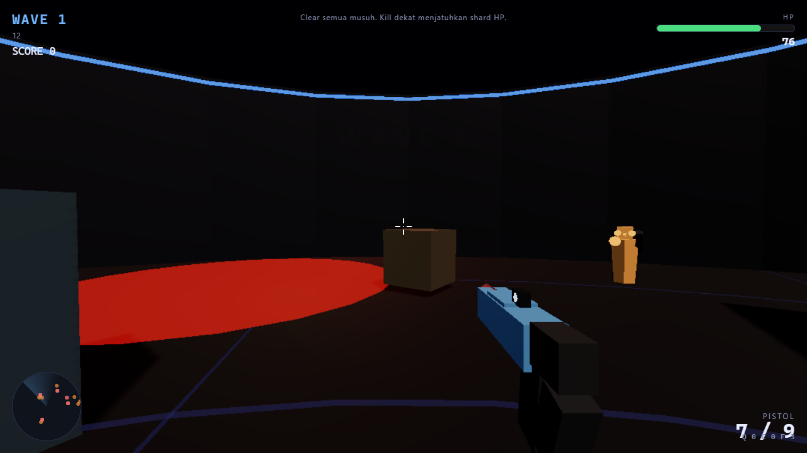
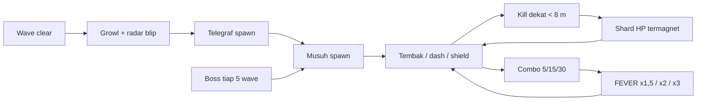

  

  

# PolyHorde

**Main di browser: https://fawwaz1st.github.io/PolyHorde/**

Arena FPS horde wave dengan gaya stylized low-poly modern. Dibangun ulang dari nol dengan Three.js r185 (WebGPURenderer + TSL bloom), arsitektur modular `core/` + `game/`, dan semua mesh/SFX prosedural — nol aset eksternal, muat instan.

Lokal: `npm install && npm run dev` — buka http://localhost:5173.

## Loop permainan

## Kontrol

WASD gerak, mouse lihat / tembak, Shift sprint, Space lompat, Q dash, E shield, F grenade, 1–4 senjata, R reload, ESC pause.

## Yang ada di dalam

- 4 senjata dengan peran jelas: pistol presisi, AR penyapu, shotgun knockback, roket AoE.
- 5 tipe musuh: grunt, shooter (flank + cover), heavy (charge), bomber (beep accelerando), boss (tiap kelipatan 5 wave).
- Ekonomi health Quake-style: kill dekat menjatuhkan shard HP yang termagnet.
- AI modern: flank, cover seek saat pemain menembak, flee saat HP kritis, Attack Token System (maks 3 melee menyerang serentak), model beranimasi (kaki berjalan, armor, tanduk boss), telegraf spawn adil.
- Game feel: hit-stop, FOV kick, screen shake, damage vignette terarah, damage number, hit marker, kill-cascade (3+ kill < 1,5 dtk → domino ledakan + time-scale 0,35x).
- Musik prosedural adaptif (Web Audio, zero aset) — layer calm crossfade combat berdasarkan kepadatan musuh & HP.
- Audio spatial: panning stereo untuk tembakan, ledakan, beep bomber, dan damage arah.
- HUD diegetik: auto-fade di luar tempur, reticle reaktif (gap melebar saat spread), radar colorblind-safe, hitung mundur wave, micro-hint onboarding JIT.
- Aksesibilitas: sensitivitas, volume, mute, reduced motion (mengikuti OS), semua persisten di localStorage.

## Performa

Zero-allocation loop: pool partikel/tracer/shard/proyektil, material & geometri di-cache, shadow statis, bloom resolution scale 0,35, chunk terpisah (app ~49 kB + three 865 kB / gzip 237 kB). Render di-skip saat menu/pause/game over. Diuji headless Chrome: 0 error.

## Struktur

`src/core/` Engine (renderer + post-processing), Input, Audio + Music, Events, Materials, Models · `src/game/` Game (loop + wave), Player, Weapons, Enemies, World, Effects, UI · `index.html` menu/HUD/markup.