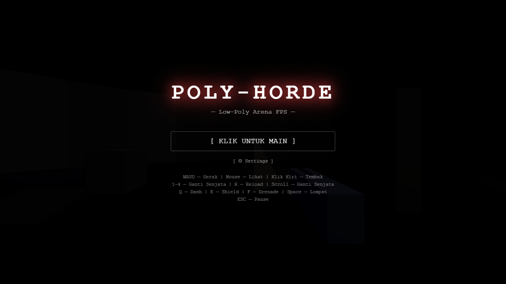
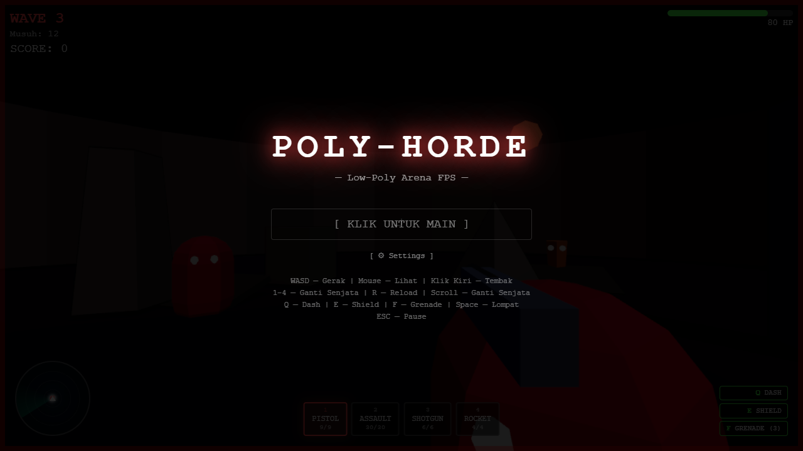
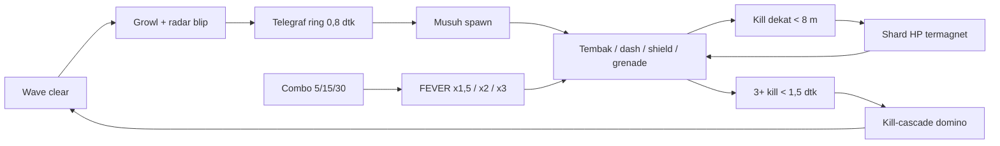

  

  

# PolyHorde

Arena FPS horde wave di browser. Low-poly, tanpa aset eksternal — semua mesh dan SFX dibuat prosedural saat runtime. Dibangun di Three.js r185 (WebGPURenderer, fallback WebGL2 otomatis) + Vite, total satu dependensi runtime.

**Main di browser: https://fawwaz1st.github.io/PolyHorde/**

Lokal: `npm install && npm run dev` — buka http://localhost:5173, klik untuk pointer lock.

## Loop permainan

## Kontrol

WASD gerak, mouse lihat, klik kiri tembak. 1–4 / scroll ganti senjata, R reload, Q dash, E shield, F grenade, Space lompat, ESC pause.

## Yang ada di dalam

- 4 senjata dengan peran beda: pistol presisi (30 dmg, spread tipis), AR penyapu (100 DPS), shotgun dengan knockback besar, roket AoE dengan self-damage 35%.
- 5 tipe musuh: grunt, shooter (flank + cover), heavy (charge), bomber (pemicu <1,2 m + beep makin cepat), boss (tiap kelipatan 5 wave, HP 3x, shard 50).
- Ekonomi health Quake-style: kill dalam radius 8 m menjatuhkan shard HP yang termagnet ke pemain — berhenti mundur, masuk ke dalam horde.
- Spawn ditelegraf ring 0,8 detik dan tidak pernah muncul di depan mata pemain (min 10 m, di luar kerucut pandang).
- FEVER: combo 5/15/30 kill memberi multiplier skor x1,5/x2/x3 + rate-up fireRate.
- Kill-cascade: 3+ kill dalam 1,5 detik memicu domino ledakan berantai (maks 8) + time-scale 0,35x.
- Radar taktis 10 Hz (sort jarak, colorblind-safe), indikator arah serangan, hit-stop, FOV punch.
- Musik prosedural adaptif (Web Audio API, zero aset) — layer calm crossfade combat, intensity mengikuti kepadatan musuh & tekanan HP.
- Story mode JIT narrative: briefing 1-2 kalimat antar wave + objective aktif di HUD.

## Performa

Loop game zero-allocation: pool objek untuk proyektil/partikel/popup, SpatialHash dengan integer key + bucket pool, material musuh Lambert dengan geometry di-cache, eye geometry merged (105→70 draw call), shadow map statis (autoUpdate=false), PointLight pre-warm (anti shader recompile), DPR cap 1,5 + scenePass resolution scale 0,8. Chunk terpisah: app ~80 kB + three 874 kB (gzip 240 kB). Diuji headless Chrome: klik → tembak → dash → switch senjata, 0 error.

## Aksesibilitas & onboarding

- Settings di pause overlay: sensitivitas mouse, volume musik, mute, reduced motion — persisten di localStorage (`polyHordeSettings`).
- Reduced motion mengikuti `prefers-reduced-motion` OS: mematikan shake, FOV punch, weapon bob, wave-announce pulse, low-HP pulse.
- Micro-hint kontekstual JIT: toast 2,6 detik pada shard/telegraph/FEVER pertama per run.
- Audio spatial-ish: StereoPanner untuk bomber beep, spawn tick, ledakan & hit pemain.
- Radar colorblind-safe: bentuk/ukuran beda per tipe + penanda arah pemain.

## Struktur

`src/engine/` game state, input, audio, event bus, story · `src/player/` kapsul fisika · `src/enemies/` AI + shard + telegraph + boss · `src/weapons/` · `src/abilities/` · `src/systems/` partikel, hash, outline · `src/ui/` HUD + radar · `index.html` menu/HUD markup.